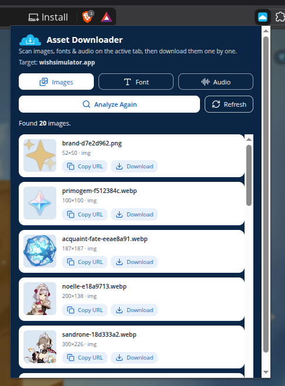

# Asset Downloader

A browser extension that scans the page you are currently viewing and lets you
**download images, fonts, and audio** one by one — no browser DevTools required.

Built with [WXT](https://wxt.dev) + React. Ships as **Manifest V3** for
Chromium browsers and **Manifest V2** for Firefox.



## Features

- **Images** — ``, `srcset`/`<picture>`, lazy-load attributes, `<video poster>`,
  CSS `background-image`, favicons, and `og:image` / `twitter:image`.
  Pexels CDN URLs are automatically upgraded to a larger size before download.
- **Fonts** — `@font-face` files (downloadable), Google Fonts links, and fonts
  actually used by the page. Click a font name to search for it on Google.
- **Audio** — `<audio>`, `<video>`, direct audio links, and `og:audio` metadata.
  Also detects sounds played through the **Web Audio API** (e.g. howler.js) by
  inspecting network traffic in the page's main world.
- **Download or copy** the URL of any detected asset.
- Scans **same-origin iframes** recursively; cross-origin iframes are skipped safely.

## Install manually

Get the ready-to-install package from the
**[Releases page](https://github.com/ren-zi-fa/assets-web-downloader/releases/latest)** —
no build tools required.

### 1. Download the release package

1. Open the [**Releases**](https://github.com/ren-zi-fa/assets-web-downloader/releases)
   page and pick the latest version.
2. Under **Assets**, download the archive for your browser:

   | Browser | Download this file |
   |---|---|
   | Chrome / Edge / Brave | `asset-downloader-<version>-chrome.zip` |
   | Firefox | `asset-downloader-<version>-firefox.zip` |

3. **Unzip** the archive. You will get a folder containing `manifest.json`,
   `background.js`, and `popup.html`.

### 2. Load it in Chrome / Edge / Brave

1. Open `chrome://extensions` (or `edge://extensions`).
2. Turn on **Developer mode** (top-right).
3. Click **Load unpacked**.
4. Select the **unzipped folder** (the one containing `manifest.json`).
5. The extension appears in your toolbar.

### 3. Load it in Firefox

**Quick way — temporary add-on (no signing):**

1. Open `about:debugging#/runtime/this-firefox`.
2. Click **Load Temporary Add-on…**.
3. Select the **`manifest.json`** inside the unzipped folder (pick the file, not the folder).
4. The extension is active until you close Firefox.

**Permanent install:** Firefox release builds require a signed add-on, so the
`.zip` cannot be installed permanently as-is. Use Firefox Developer Edition or
Nightly (`about:config` → `xpinstall.signatures.required = false`), or wait for a
signed `.xpi` to be attached to the Release once signing is enabled — then
install it via `about:addons` → gear icon → **Install Add-on From File…**.

### 4. Use it

1. Open any normal website (e.g. a gallery or an image-heavy page).
2. Click the Asset Downloader icon in the toolbar.
3. Pick a tab — **Images**, **Font**, or **Audio**.
4. Click **Analyze** (the button label follows the selected tab).
5. For each result, use **Copy URL** or **Download**.

> The extension cannot scan browser-internal pages (e.g. `about:`, `chrome://`,
> `edge://`, or the New Tab page). Open a regular `http(s)` page instead.

## Updates

1. Download the newer package from the
   [Releases page](https://github.com/ren-zi-fa/assets-web-downloader/releases/latest).
2. Unzip it over your existing folder (replace the old files).
3. Reload the extension:
   - Chrome: press the reload icon on the extension card at `chrome://extensions`.
   - Firefox: click **Reload** at `about:debugging#/runtime/this-firefox`.

## Troubleshooting

| Problem | Fix |
|---|---|
| "No active tab to scan." | Open a normal `http(s)` page and click the extension icon again. |
| Popup says the page cannot be scanned | Browser-internal pages cannot be injected. Use a regular website. |
| Downloads do nothing | Check that the site's assets are reachable and that the extension still has the **Downloads** permission. |
| Old icon or stale build | Reload the extension after replacing the files (`chrome://extensions` or `about:debugging`). |
| Audio not found on a music site | Segmented/encrypted streams (Spotify, YouTube, SoundCloud) expose no single file; an empty result is expected there. |

## Building from source

Only needed if you want to modify the code or cut your own package.

Requirements: [Node.js](https://nodejs.org) **22 or newer** (npm included).

```bash
git clone https://github.com/ren-zi-fa/assets-web-downloader.git
cd assets-web-downloader
npm install

npm run dev           # Chrome with hot reload
npm run dev:firefox   # Firefox with hot reload
npm run compile       # TypeScript type-check only

npm run zip           # Chrome package  -> .output/asset-downloader-<version>-chrome.zip
npm run zip:firefox   # Firefox package -> .output/asset-downloader-<version>-firefox.zip
```

> Prefer [pnpm](https://pnpm.io)? Just swap `npm run <script>` for `pnpm <script>`.

## License

Released under the [MIT License](LICENSE).


