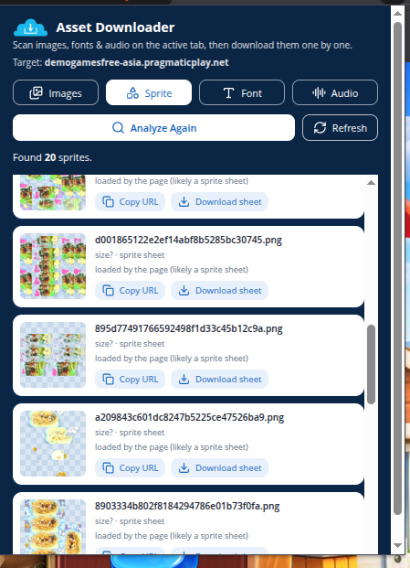

# Asset Downloader

<p align="center">
  
</p>

<h3 align="center">Scan and download images, sprites, fonts, and audio from any web page.</h3>

<p align="center">
  <a href="https://github.com/ren-zi-fa/assets-web-downloader/releases/latest"></a>
  <a href="https://github.com/ren-zi-fa/assets-web-downloader/releases"></a>
  <a href="https://github.com/ren-zi-fa/assets-web-downloader/actions/workflows/ci.yml"></a>
  <a href="LICENSE"></a>
  
  
</p>

Asset Downloader is a browser extension that scans the page you are viewing and
lets you **download images, sprites, fonts, and audio** one by one — no browser
DevTools required. Built with [WXT](https://wxt.dev) + React, published as **Manifest V3**
for Chromium browsers and **Manifest V2** for Firefox.



Full user docs — features, installation guide, and FAQ — are on the landing page at
**[ren-zi-fa.github.io/assets-web-downloader](https://ren-zi-fa.github.io/assets-web-downloader/)**
(available in Indonesian and English).

## Install

No build tools required. Grab the ready-made package from the
**[Releases page](https://github.com/ren-zi-fa/assets-web-downloader/releases/latest)**,
unzip it, and load it as an unpacked extension (`chrome://extensions` with
Developer mode on, or `about:debugging` on Firefox). Step-by-step instructions
with screenshots are on the landing page at
[ren-zi-fa.github.io/assets-web-downloader](https://ren-zi-fa.github.io/assets-web-downloader/).

## Building from source

Only needed if you want to modify the code or cut your own package.
Requires [Node.js](https://nodejs.org) **22 or newer**.

```bash
git clone https://github.com/ren-zi-fa/assets-web-downloader.git
cd assets-web-downloader
pnpm install

pnpm dev           # Chrome with hot reload
pnpm dev:firefox   # Firefox with hot reload
pnpm compile       # TypeScript type-check only

pnpm zip           # Chrome package  -> .output/asset-downloader-<version>-chrome.zip
pnpm zip:firefox   # Firefox package -> .output/asset-downloader-<version>-firefox.zip
```

## License

Released under the [MIT License](LICENSE).
